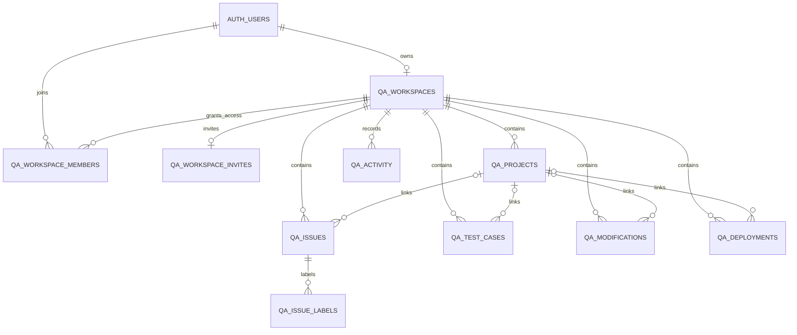

# VEXA relational database

Apply [`migrations/20261031143252_relational_workspace.sql`](migrations/20261031143252_relational_workspace.sql) once in the SQL Editor of a fresh Supabase project. The script runs in a transaction. No application table has a `json` or `jsonb` column.

Then apply [`migrations/20261031143409_harden_rls_auto_enable.sql`](migrations/20261031143409_harden_rls_auto_enable.sql). It revokes client execution of Supabase's optional `public.rls_auto_enable()` event-trigger helper, while retaining automatic RLS setup. It safely skips projects without that helper. Both filenames match the migration versions applied to the VEXA project.

## Tables

| Table                  | Primary key                          | Stored data                                                                                              |
| ---------------------- | ------------------------------------ | -------------------------------------------------------------------------------------------------------- |
| `qa_workspaces`        | `user_id`                            | Owner, current sprint name/goal, revision, creation/update timestamps                                    |
| `qa_workspace_members` | `(workspace_owner, member_id)`       | Invited auth account, email display snapshot, join timestamp                                             |
| `qa_workspace_invites` | `workspace_owner`                    | Unique invite code, creation time, expiry                                                                |
| `qa_projects`          | `(workspace_owner, id)`              | Project name, Department/Section, developer display name                                                 |
| `qa_issues`            | `(workspace_owner, id)`              | Project FK, title, description, status, priority, type, assignee display name, integer XP, creation time |
| `qa_issue_labels`      | `(workspace_owner, issue_id, label)` | Individual quest labels with an issue FK                                                                 |
| `qa_test_cases`        | `(workspace_owner, id)`              | Project FK, title, module, execution steps, expected result, status, last-run timestamp                  |
| `qa_modifications`     | `(workspace_owner, id)`              | Project FK, historical project name, module, details, priority, status, developer display name, notes    |
| `qa_deployments`       | `(workspace_owner, id)`              | Project FK, historical project name, environment, version, deployment date, status, notes                |
| `qa_activity`          | `(workspace_owner, id)`              | Activity description, occurrence timestamp, kind                                                         |

Entity tables retain display order and creation/update timestamps. Labels retain their display order. Foreign keys, membership lookups, and the main status/date filters have indexes.

## Model decisions

- One account owns one workspace, matching the current product. `qa_workspaces.user_id` is both its primary key and a foreign key to `auth.users`.
- Every entity key is scoped to its workspace. Composite project and issue foreign keys reject references into another owner's workspace, even if the caller belongs to both teams.
- Record IDs remain text to preserve existing `VXA-...`, `TC-...`, and local UUID identifiers. Authentication identifiers remain UUIDs.
- Project deletion clears only `project_id`, preserving quests, tests, modifications, and deployments. Titles and explicitly named project snapshots keep the history readable after deletion. Deleting a workspace or its owner cascades through owned records, memberships, and invites.
- Developers and assignees are editable assignment names in this application. They are not auth accounts or authorization roles. Department/Section is a single free-text field. Creating artificial user or department records for these fields would change the product's meaning.
- Labels are rows, with uniqueness per issue. Repeated or blank labels from the UI are normalized before saving.
- Checks constrain quest types, priorities, statuses, environments, nonnegative integer XP, real deployment dates, and valid test-result/timestamp combinations. Passed/Failed tests require a last-run timestamp; Not Applicable/Not Tested require NULL.
- Activity is the existing editable, bounded workspace feed, not an immutable security audit log. The client retains its latest 40 events.

## Reads, saves, and sharing

`read_qa_workspace(workspace_owner)` reads all relational tables in one SQL statement under the caller's RLS policies, so the result and revision come from one consistent database snapshot. It returns an HTTP response containing the client workspace shape. JSON is a transport format here; no document is stored in a table.

`save_qa_workspace(payload, expected_revision, workspace_owner)` validates the request, checks the caller, locks membership for a shared save, and locks the workspace revision. It upserts changed rows, removes deleted rows, saves sprint settings, and advances the revision in one transaction. An invalid row rolls back the entire operation. A stale revision raises SQLSTATE `40001`; the existing client fetches the latest version and performs its three-way merge before retrying. New workspace creation uses revision zero and is restricted to the owner.

Each entity is individually queryable through the Data API using authorized SELECT requests. The existing UI still saves a workspace transaction as a unit. It does not issue separate browser writes to each entity table, which would allow partial saves and bypass the concurrency check.

RLS is enabled on all ten tables. Owners and members can read workspace content. Only owners can read/disable their invite codes and remove memberships. Content-table INSERT/UPDATE/DELETE privileges are revoked from client roles. Membership inserts and invite creation are also restricted to checked RPCs.

Public RPCs use `SECURITY INVOKER`. The privileged save/invitation implementations live in `vexa_private`, use an empty search path, check `auth.uid()` themselves, and have explicit execution grants. Keep `vexa_private` out of the Data API's exposed schemas. Authorization never uses editable user metadata or the member email display snapshot.

`create_qa_workspace_invite()` creates or rotates the owner's seven-day code. `join_qa_workspace(invite_code)` validates an unexpired code and adds the caller to that workspace. Disabling a code prevents new joins; removing a member revokes subsequent database access. Rotate or disable the code as well to prevent that person from rejoining.

Realtime publishes the workspace revision row. After a committed save, clients fetch the complete relational snapshot. Ten-second checks and focus/reconnect refreshes remain enabled.

## Existing installations

This is a replacement baseline for new installations. The former `001_workspace.sql` and `002_shared_realtime.sql` files were removed. Deleting migration files does not undo SQL already run on a remote project.

The baseline deliberately stops if VEXA tables already exist. It contains no DROP TABLE, no database reset, and no automatic deletion or conversion of existing cloud data. Do not run it over the previous JSON schema. Keep that installation and its backups intact; use a fresh Supabase project for this baseline, or prepare a separately reviewed data-conversion migration before upgrading an installation with records. Point the updated application at the relational project: the old schema does not provide `read_qa_workspace` and is no longer supported by the updated client.

## Verification

Run `npm.cmd run typecheck`, `npm.cmd test`, and `npm.cmd run build` (use `npm` outside Windows). `src/lib/relational-workspace.test.ts` executes this exact migration against embedded PostgreSQL with real roles and RLS, and mocked Supabase auth claims. It checks zero JSON columns, indexed foreign keys, private definer functions, record round trips, history retention, rollback, stale revisions, isolation, invites, and revocation.

The embedded tests do not run Supabase Auth, PostgREST, or the websocket service. After applying the baseline, run the two-account checks in the root README against the actual project. Confirm `public` is exposed through the Data API and `qa_workspaces` is in `supabase_realtime`. The migration grants client SELECT and RPC execution explicitly; it does not rely on automatic table exposure. Run Supabase's security/performance advisors against that project after deployment.

References: [RLS](https://supabase.com/docs/guides/database/postgres/row-level-security), [database functions](https://supabase.com/docs/guides/database/functions), [Postgres Changes](https://supabase.com/docs/guides/realtime/postgres-changes).
